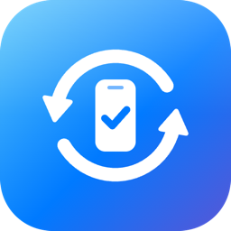
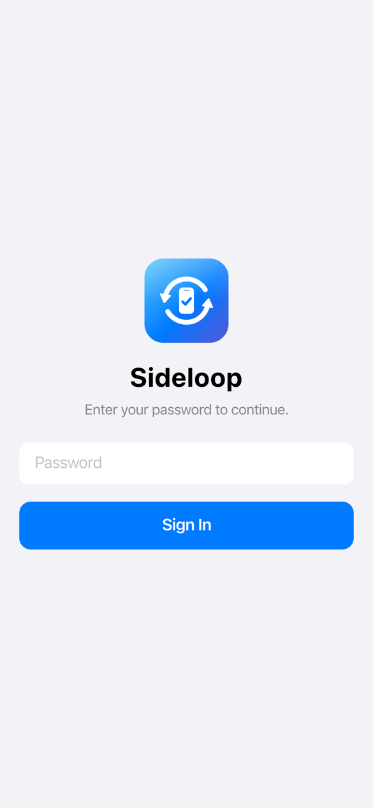
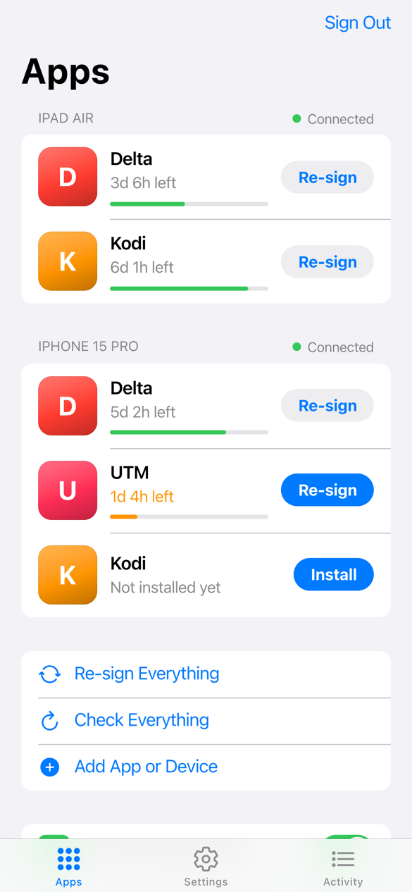
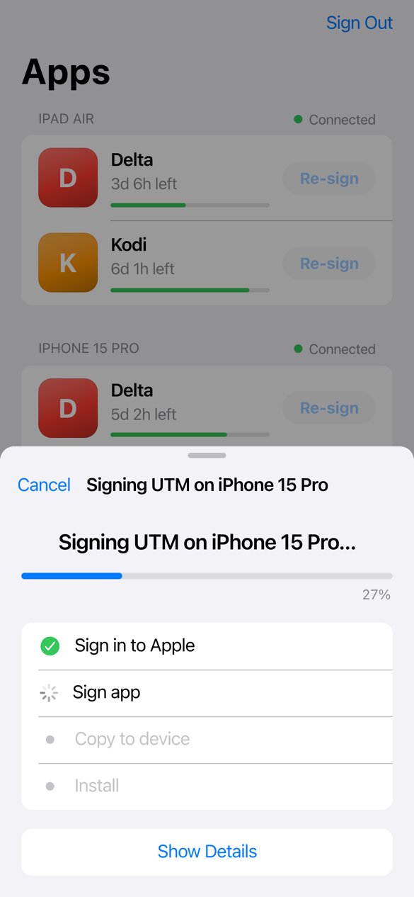
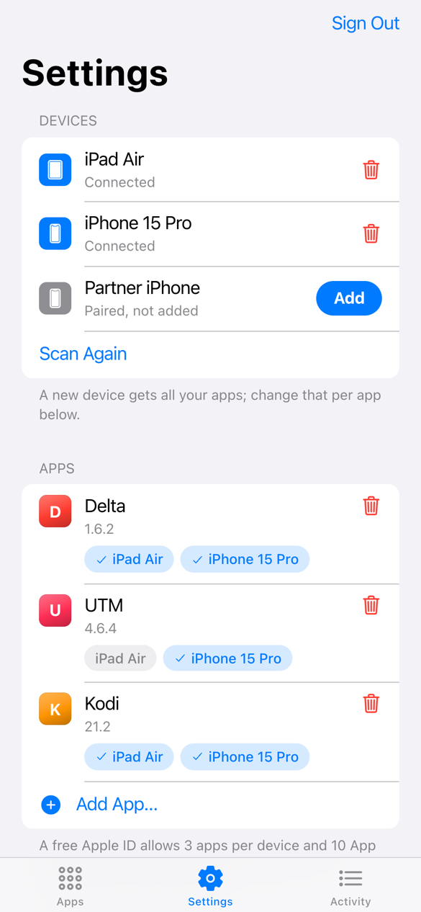
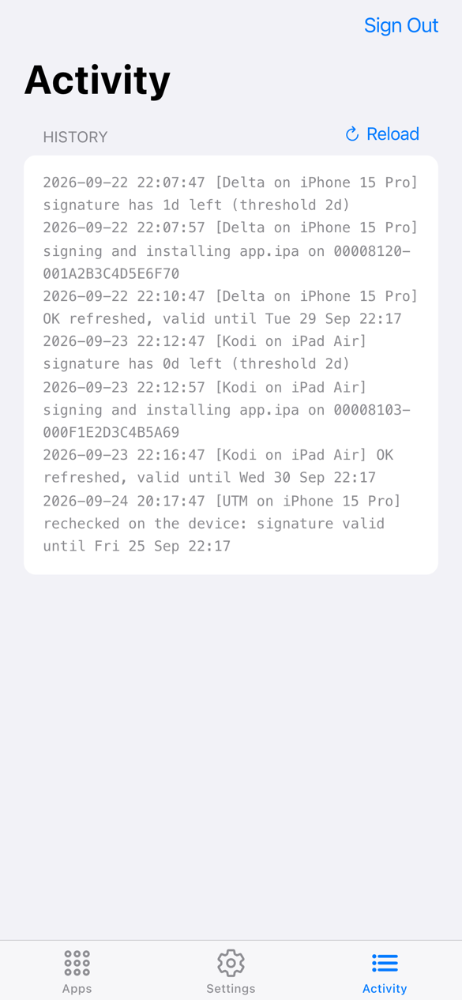

<div align="center">
  <a href="https://github.com/filippofinke/sideloop">
    
  </a>
  <h3 align="center">Sideloop</h3>
</div>

> Keep sideloaded IPAs signed with a free Apple ID, re-installed over Wi-Fi before the 7-day signature expires.

A small self-hosted service with a web UI for any Linux machine (amd64 or arm64) or a Mac. It re-signs your apps with [AltServer-Linux](https://github.com/jaakkopalvaila/AltServer-Linux) and installs them in place, so app data is kept. You don't need AltStore or SideStore on the device.

## Features

- [x] Multiple apps on multiple iPhones and iPads
- [x] Automatic re-signing when a device comes online, before the signature expires
- [x] Web UI for pairing, uploading IPAs, 2FA codes and live progress
- [x] Checks each IPA for FairPlay encryption, tweaks and app extensions
- [x] Apple sign-in with Mac anisette data, stopping automatic retries before Apple locks the account
- [x] Python standard library only, one Docker image for amd64 and arm64

## Demo

https://github.com/user-attachments/assets/8c6b799d-b9e7-4a15-898d-d96a2af8e876

A two-minute narrated walkthrough: setup, adding devices and apps, the first install with a 2FA code, and automatic re-signing.

## Screenshots

| Login | Apps | Signing | Settings | Activity |
| :---: | :---: | :---: | :---: | :---: |
|  |  |  |  |  |

## Quick Start

Prerequisites

- Docker with Compose
- A throwaway Apple ID

Run on Linux

```bash
git clone https://github.com/filippofinke/sideloop.git
cd sideloop
cp .env.example .env
docker compose up -d
```

When updating from a version that ran its own anisette container, use `docker compose up -d --build --remove-orphans` to remove it.

The first build compiles AltServer, which takes a few minutes. On a small board like a Raspberry Pi 3 it is much faster to build on another arm64 machine and copy the image over:

```bash
docker build --platform linux/arm64 -t sideloop .
docker save sideloop | gzip | ssh pi@<host> 'gunzip | docker load'
ssh pi@<host> 'cd sideloop && docker compose up -d --no-build'
```

Open `http://<host>:8080` and set a password. Then pair a device over USB, add an IPA and enter your Apple ID.

Run on macOS

Docker on macOS can't see USB or Wi-Fi devices, so bridge the system usbmuxd first:

```bash
socat TCP-LISTEN:27015,bind=127.0.0.1,reuseaddr,fork UNIX-CONNECT:/var/run/usbmuxd &
docker compose -f docker-compose.yml -f docker-compose.mac.yml up -d
```

Pair the device in Finder and enable **Show this iPhone when on Wi-Fi**.

## Notes

- Use the Apple ID's **regular password**. App-specific passwords don't work.
- Apple asks for a **2FA code** on the first sign-in. After that, sign-ins are silent.
- The device must be **unlocked and on the same Wi-Fi** while a re-sign runs.
- A free account allows 3 apps per device and 10 App IDs per week. Each app extension needs its own App ID.
- Trust the developer once in **Settings > General > VPN & Device Management**. Refreshes keep it trusted.
- If Apple sign-in stops working, update `ALTSERVER_TAG` in the `Dockerfile`. AltServer is built from that tag with the patches in `altserver/`.
- Apple sign-in needs anisette data from a Mac identity. By default it comes from SideStore's public server, `https://new.ani.sidestore.io`, which never receives your Apple ID or password. Set `ANISETTE_SERVER` in `.env` to use another one.
- After 3 sign-ins refused by Apple, automatic re-signing pauses so the Apple ID doesn't get locked. Pressing **Sign** in the web UI tries again and resumes it once it works.

Data is stored in `./data`.

## Author

👤 **Filippo Finke**

- Website: [https://filippofinke.ch](https://filippofinke.ch)
- Twitter: [@filippofinke](https://twitter.com/filippofinke)
- GitHub: [@filippofinke](https://github.com/filippofinke)
- LinkedIn: [@filippofinke](https://linkedin.com/in/filippofinke)

## Show your support

Give a ⭐️ if this project helped you!

<a href="https://www.buymeacoffee.com/filippofinke">
  
</a>

## 📝 License

Copyright © 2026 [Filippo Finke](https://github.com/filippofinke).<br />
This project is [MIT](./LICENSE) licensed. Icons from [Ionicons](https://ionic.io/ionicons) (MIT).

***

_Not affiliated with Apple. Use a throwaway Apple ID._
